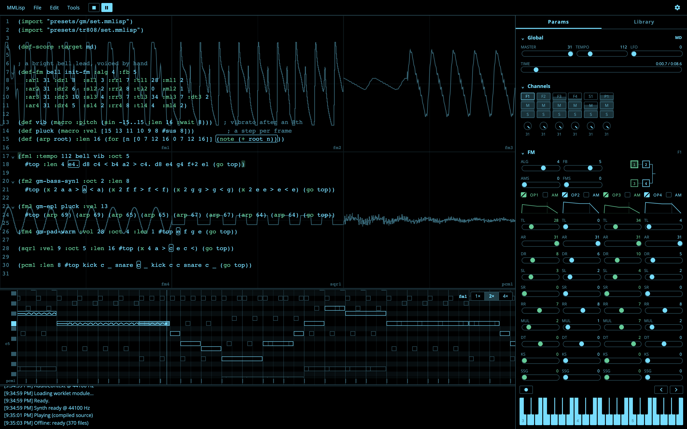

# MMLisp

MMLisp is a Lisp-like music language for retro sound chips, built first for the
Sega Mega Drive (YM2612 FM + SN76489 PSG). You write scores as s-expressions,
audition them instantly in a browser authoring environment running the chips'
emulators, and compile them to a compact binary for a Mega Drive sound driver —
with a design built around *interactive* music: tracks that start, stop, layer,
and respond to game state at runtime. The same language writes for the
PC-8801, the X68000, the MSX, the PC Engine and the Famicom, auditioned in the
browser and exported as VGM.

- **Try it now:** https://mmlisp.com/
- **Playback driver:** MMLispDRV (68k sequencer + Z80 PCM/write engine, SGDK
  integration) — trace-verified against the JS reference in emulation.



## Highlights

- **Music as code, not a tracker.** Scores are Lisp s-expressions — name a voice
  once and reuse it, factor phrases into definitions with arguments, build
  envelopes and LFOs from composable curves. `let`, `for` and `if` generate
  runs, arpeggios and accents when the score compiles
  (`(for [i 0..15] (if (= (mod i 4) 0) (note 72) (note 60)))`), so the driver
  never pays for them. A programming language's expressiveness, aimed at the
  YM2612 + PSG.
- **Hear it instantly, accurately.** [MMLisp Live](https://mmlisp.com/)
  auditions your score in the browser through the chips' emulators — a
  cycle-accurate **Nuked-OPN2** for the YM2612, **ymfm** for the other
  machines' — fed the same register writes the real chips see, and hot-swaps
  the recompiled score without stopping playback.
- **The whole chip, as language.** Per-operator envelope and LFO macros,
  cent-accurate glide and vibrato, chiptune arpeggios (`:semi`) and drum rolls
  (`:keyon`), **FM3 independent-operator mode** and CSM, and samples on the
  fm6 DAC (`pcm1`–`pcm3`, one to three voices) — advanced YM2612 techniques
  you write, not hand-poke, in the browser and on the driver alike.
- **Beyond the Mega Drive.** `(def-score :target pc88)`, `x68k`, `msx`,
  `pce` or `fc` holds a score to the PC-8801, the X68000, the MSX, the PC
  Engine or the Famicom: their chips' own
  channels and words, auditioned in Live and exported as VGM — see
  [Machines](#machines).
- **Interactive by design.** Tracks start, stop, layer and fade at runtime,
  sound effects take channels from the song and give them back, and `def-val`
  slots let game code drive parameters live via `$name` — in Live, an XY pad
  plays two of them under one finger.
- **MMLispDRV, built for a game's frame.** The driver splits across both CPUs:
  the 68000 sequences the score a frame ahead and releases it on the video
  clock, the Z80 keeps a fixed-rate DAC clock of its own, so a heavy game
  frame delays nothing that was ready. Every register write it makes is
  checked **byte-for-byte** against the JS reference at zero tolerance — what
  you hear in the browser is what the driver emits. SGDK integration included;
  verified in emulation and played on hardware.
- **Turn a recording into FM.** Give MMLisp Live a recording — WAV, MP3, M4A,
  FLAC — and the chip plays it back, two ways. **Audio as Formants** follows
  the sound's four spectral peaks frame by frame on FM3's four operators: under
  CSM the buzz through them is a vocoder's voice — say a phrase and the Mega
  Drive says it back — and as sine waves it is sine-wave speech. **Audio as FM
  Voice** searches a model of the YM2612 for a patch: give it one recorded
  note — a bass, an electric piano, a bell, a snare — and it offers three
  voices, nearest first, to hear against the recording and play on the
  keyboard before one goes into the score.
- **Bring songs and voices in.** DefleMask, Furnace, TFI / VGI / OPNI,
  mucom88, MIDI, VGM and a SoundFont's drum kit import as scores and voices.
  Driver songs import for their own machine as their driver plays them —
  MDX (X68000) held to MXDRV, MGS (MSX) to MGSDRV, mucom88 (PC-8801) to
  mucom88, each compared against the driver frame by frame — and come out
  as readable scores, their repeats folded back into loops and definitions.
- **Compose with an AI.** An [MCP server](tools/mcp/README.md) gives Claude
  Code, Claude Desktop or any MCP client the language reference, the real
  compiler's diagnostics and WAV renders — and, with **Tools > Connect to AI**,
  the score open in MMLisp Live: the AI edits it and plays it while you listen,
  every change one undo away. Plain text scores are a language an AI can write.

## Machines

| `:target` | Machine | Chips | In Live | Out |
| --- | --- | --- | --- | --- |
| `md` (default) | Sega Mega Drive | YM2612 FM + DAC PCM, SN76489 PSG | Nuked-OPN2, Nuked-PSG | MMB for MMLispDRV, VGM, WAV |
| `pc88` | PC-8801 + Sound Board II | YM2608: FM, SSG, ROM rhythm, ADPCM-B | ymfm | VGM, WAV |
| `x68k` | X68000 | YM2151 FM, MSM6258 ADPCM (PCM8's eight voices) | ymfm | VGM, WAV |
| `msx` | MSX + SCC + FM-PAC | AY-3-8910 PSG, Konami SCC, YM2413 FM | ymfm, the SCC's own | VGM, WAV |
| `pce` | PC Engine | HuC6280: six wave channels, noise, LFO, DDA | its own | VGM, WAV |
| `fc` | Famicom + its expansions | 2A03: two pulses, triangle, noise, DMC; VRC6, FDS, MMC5, Sunsoft 5B, VRC7, N163 | its own, ymfm (5B, VRC7) | VGM (without the VRC6, MMC5, N163), WAV |

The Mega Drive has a driver for games (below); the other machines are
composed in Live and delivered as VGM, which existing players run. Each
machine's own sound is language: FM3's independent operators and CSM on the
Mega Drive; the SSG's hardware envelope as a buzzer (`:env 8 :env-rate note`)
on the PC-8801 and the MSX; DT2 and the OPM's LFO on the X68000; the SCC's
32-step waves as `def-wave` — drawn by hand, or `+ - * /` over curves that
move with a `$` value — and the FM-PAC's two operators, fifteen ROM voices
and its rhythm, pitched and bent per hit; the PC Engine's waves stepped by a
note's `(macro :wave …)`, its LFO written as an FM LFO is, and one channel's
wave, noise and DDA layered by `:prio`; the Famicom's pulse `:duty`, a
triangle with no level, DMC samples, and every expansion chip a cartridge
or the Disk System added, named by chip (`vrc6-saw`, `fds-wave` with its
modulation as the song's LFO, `n163-wave1`–`8` taking turns as the chip
does). The YM2608's rhythm ROM is
Yamaha's and not included: Live plays your own, or stands the score's kit in
for it. Other machines are on the [roadmap](docs/roadmap.md).

## What it looks like

```lisp
(def-fm epiano :alg 4 :fb 2
  :ar1 31 :dr1 8 :sr1 2 :rr1 8 :sl1 2 :tl1 28 :ks1 0 :ml1 2 :dt1 3
  :ar2 31 :dr2 12 :sr2 3 :rr2 8 :sl2 3 :tl2 4 :ks2 0 :ml2 1 :dt2 0
  :ar3 31 :dr3 8 :sr3 2 :rr3 8 :sl3 2 :tl3 32 :ks3 0 :ml3 6 :dt3 -3
  :ar4 31 :dr4 12 :sr4 3 :rr4 8 :sl4 3 :tl4 4 :ks4 0 :ml4 1 :dt4 0)

(def hat (macro :vel [15 8 2]))

(fm1 :tempo 112 epiano :oct 4 :len 8      ; FM electric piano, arpeggiated line
  c e g b > c e d c <)

(sqr1 :oct 5 :len 4 :vel 9     ; PSG square counter-line
  e g a b)

(noise :len 8 hat              ; PSG noise as a hi-hat via a velocity macro
  c c c c  c c c c)
```

Paste it into [MMLisp Live](https://mmlisp.com/), press Cmd/Ctrl+Enter,
and you get an FM e-piano arpeggio over a square-wave line with a ticking
noise hat — synthesized by the same register writes the real chips would see.

## MMLisp Live (web authoring environment)

`live/` hosts the whole authoring workflow in the browser — no install, and
installable to run offline.

**Writing.** A CodeMirror editor with MMLisp highlighting, template
completions, a voice/sample picker (`@`, or long-press a name), formatting,
structure help (bracket auto-close, enclosing-form highlight, select by form)
and multi-cursor find / replace. The panel's editor follows the cursor: in a
voice it is the FM operators (four, or the FM-PAC's two), in a `def-wave` or
a macro's steps a vector editor where the values are drawn as bars and
written back to the score. The Library (Cmd/Ctrl+K) searches the
language reference, the preset sets, the snippets and the example scores, each
auditionable and insertable. Edit > Loop Selection wraps notes or channels in a
loop; Edit > Logical Editor finds notes by pitch, length or voice and changes
them together. The reference and snippets read in English, Japanese or Spanish.

**Hearing and playing.** A Nuked-OPN2 (YM2612) WebAssembly core in an
AudioWorklet; Build (Cmd/Ctrl+B), Play and value edits swap the recompiled
score in at the next bar without stopping. A piano roll, an oscilloscope and
Follow Playback; the FM parameter panel — the machine's own operators and
registers, the FM-PAC's two on msx — live from playback and editable while
it runs; one slider per `def-val` and an XY pad; channel mute / solo; the
on-screen keyboard and a MIDI keyboard to play and step-input, with MIDI Learn
for a controller's knobs.

**Bringing sounds in** (File > Import, or drop the file):

- FM voices from DefleMask, Furnace, TFI, VGI, OPNI and mucom88 banks; drum
  samples from mucom88 PCM banks and SoundFont kits
- Songs from MIDI, DefleMask, Furnace (a PC Engine module as a `pce`
  score, an NES one as an `fc` score with its DPCM samples, its VRC6 and
  FDS channels), VGM (with its
  PCM: the YM2612 DAC, SegaPCM, YM2610 ADPCM, the OKIM6258, the 2A03's DMC;
  a YM2151's, a YM2608's, an AY-3-8910's, an SCC's, a HuC6280's or a
  2A03's as its own machine's score, the SSG's hardware envelope included;
  a YM2413's or a VRC7's notes on their own voices, read on four
  operators) and mucom88, through a dialog for tempo and channels; MDX
  (with its PDX) as an X68000 score and MGS as an MSX one
- Recordings, in WAV or any format the browser decodes: **Audio as Formants**
  (a sound's spectral peaks on FM3's operators — CSM's vocoder voice, or
  sine-wave speech; on x68k, msx and pce the sine waves) and **Audio as FM Voice** (a patch searched for one note,
  three candidates to hear and play before choosing)
- A folder (File > Open Folder…), or a `.zip` / `.lzh` opened as one in any
  browser, a phone's too: File > Files in Folder lists its scores and songs, a
  song opens converted and finds its PDX or mucom88 banks beside it, and a
  downloaded song pack needs no unpacking

**Saving and sharing.** VGM, WAV and video export, PCM included; `.mmlisp`
files opened and saved in place, File > Open Recent, and the score kept in the
browser between launches; File > Share… makes a short link that opens the
score.

**With an AI.** Tools > Connect to AI lets Claude Code or Claude Desktop, with
the [MMLisp MCP server](tools/mcp/README.md), read, edit and play the open
score — every change logged and undoable.

Keyboard shortcuts: [docs/guide.md §28](docs/guide.md#28-keyboard-shortcuts-in-the-live-app).

## MMLispDRV (the hardware driver)

MMLispDRV plays a compiled score (`.mmb`) using both Mega Drive CPUs. The
**68000** runs the sequencer — it walks the score, runs the tick accumulators,
sweeps and macros, composes levels and pitch, and renders each frame into
register writes, which it hands to the Z80 in one short bus grab a frame. The
**Z80** keeps a fixed DAC clock from its own instruction stream, mixes up to
three PCM voices on it, and puts the FM writes on the YM2612 between samples
([docs/driver.md](docs/driver.md)). A score picks its engine image with
`(def-score :pcm-voices N)`: one voice at 14,376 Hz, two at 10,112 Hz, three at
6,653 Hz.

It plays FM + PSG voices and the full level model, motion (sweeps / glide /
vibrato / tempo ramps), FM3 independent-operator mode and CSM, the macro
engine, dynamic value slots, PCM with loop points that move while a note
plays, and sound effects (`def-se`, played by the game with `MMLisp_playSe`).

It's built reference-first: a JS implementation (`drv-player.js`) validated in
MMLisp Live, then a C sequencer whose **every register write is checked
byte-for-byte against it at zero tolerance** on the whole gate corpus, and
an SGDK build
graded write by write and DAC byte by DAC byte in an emulator. See
[docs/driver.md](docs/driver.md) for the architecture,
[drv/README.md](drv/README.md) for building and verification, and
[docs/roadmap.md](docs/roadmap.md) for what is still ahead.

## Repository Structure

- `docs/` — language reference, driver design, formats
- `live/` — MMLisp Live web authoring environment (editor, compiler, player)
- `drv/` — MMLispDRV: the 68k sequencer, the Z80 engine generator, SGDK
  integration, and a first-party toolchain (assembler, Z80 emulator, gates)
- `examples/` — demo songs and test assets
- `tools/` — command-line compiler and validation scripts, and the MCP server
  that lets an AI client write and check scores ([tools/mcp](tools/mcp/README.md))
- `presets/` — the voice and sample sets the app ships
- `mmlisp-syntax/` — VS Code TextMate grammar for `.mmlisp`
- `wasm/`, `third_party/` — the vendored chip cores (Nuked-OPN2, Nuked-PSG,
  ymfm) and their WASM build

File extensions: `.mmlisp` (source score) · `.mmb` (compiled binary song data).

## Documents

- [docs/cheatsheet.md](docs/cheatsheet.md) — the language on two pages
- [docs/language.md](docs/language.md) — canonical language reference
- [docs/guide.md](docs/guide.md) — composer's guide (tutorial)
- [docs/ir.md](docs/ir.md) — IR JSON reference (compiler output)
- [docs/mmb.md](docs/mmb.md) — MMB binary container format
- [docs/opcodes.md](docs/opcodes.md) — MMB opcode and target tables
- [docs/driver.md](docs/driver.md) — MMLispDRV architecture and verification
- [docs/pcm-multibank.md](docs/pcm-multibank.md) — PCM beyond one 32 KiB bank
- [docs/roadmap.md](docs/roadmap.md) — what is still ahead

## Development

```
cd live && npm run serve        # the app on :5173/live/ (serve:https for HTTPS)
cd drv && npm run verify:all    # the driver's gates
cd tools && npm run check:snapshot   # the toolchain's output against its baseline
```

`tools/README.md` lists every check.

**Publishing.** The deployed site serves `live/` as its document root, while
`npm run serve` serves the repository root and reaches the app at `/live/`. The
data the app fetches by absolute path lives outside `live/`, so it reaches the
published site through the tracked symlinks `live/examples` and `live/presets`.
A new directory the app fetches from needs one too, or it resolves in
development and 404s in production.

The editor (CodeMirror) and the UI font are vendored in `live/vendor/`,
rebuilt by `live/scripts/vendor/` (`npm install && npm run build`) when
bumping them.

The installed app works offline: on every launch it caches, through its
service worker (`live/sw.js`), every file it can fetch
(`live/src/offline-cache.js`), found by following references from the page,
the worklet and the preset/snippet/example indexes — so a new file needs no
list, only a reference from one of those. The console says when it is ready.

## Acknowledgements

This project directly references the following works in its design and implementation:

- **[SGDK (Sega Genesis Dev Kit)](https://github.com/Stephane-D/SGDK)** — Z80 driver infrastructure and toolchain conventions for Mega Drive homebrew.
- **[MDSDRV](https://github.com/superctr/MDSDRV)** — Sound driver for Sega Mega Drive. Invaluable reference for register usage patterns and real-hardware timing.
- **[PMD](https://en.touhouwiki.net/wiki/User:Mami/Music_Dev/PMD)** — Professional Music Driver for PC-98 by KAJA. Influenced the MML command model and track sequencing design.
- **[NDP](https://ndp.squares.net/web/)** — PSG sound driver and MML authoring tool for MSX by naruto2413. Influenced the score and MML authoring model.
- **[mucom88](https://github.com/onitama/mucom88)** — MML sound driver for the PC-8801 (OPNA) by Yuzo Koshiro, maintained by onitama; licensed CC BY-NC-SA 4.0. Referenced for the `.muc` / `.dat` import path — MML command model and clock-grid note timing.
- **[Nuked-OPLL](https://github.com/nukeykt/Nuked-OPLL)** — YM2413 emulator by nukeykt. Its dumps of the YM2413's and the VRC7's ROM voices are the FM-PAC's built-in voices and the VGM import's VRC7 voices.
- **[Furnace](https://github.com/tildearrow/furnace)** / **[DefleMask](https://www.deflemask.com/)** — Multi-system chiptune trackers referenced for tracker workflow, pattern sequencing, and chip-focused composition practices.
- **MXDRV** — MML sound driver for the X68000. Its MDX format and its playback, as [portable_mdx](https://github.com/yosshin4004/portable_mdx) ports its 68000 code, are the reference for the `.mdx` / `.pdx` import.
- **[MGSDRV](https://gigamix.hatenablog.com/entry/mgsdrv/)** — MML sound driver for the MSX by Ain / GIGAMIX. MGSC's MML reference and the driver's playback are the reference for the `.mgs` import.
- **[Lhasa](https://github.com/fragglet/lhasa)** — LHA decompressor by Simon Howard; ISC license. Its test archives, made by LHA tools on many machines, held the `.lzh` reader to them, and its decoders settled `-lh4-`.

## License

MIT License — Copyright (c) 2026 Hiroshi Okamura (5&UP Inc.)

See [LICENSE](LICENSE) for the full text.

This repository also vendors the chip cores it emulates with, each licensed
separately: `Nuked-OPN2` (LGPL-2.1-or-later), `Nuked-PSG`
(**GPL-2.0-or-later**) and `ymfm` (BSD-3-Clause), all under `third_party/`.
MMLisp Live ships builds of them (`live/nuked-opn2.js`, `live/nuked-psg.js`
and the `live/ymfm-*.js` cores), so a distribution of the app carries those
terms for those components. See `THIRD_PARTY_NOTICES.md` and each core's
`LICENSE`.

### mucom88 import

The `.muc` / `.dat` importer (`live/src/import-mucom.js`) is original code that
**interoperates with** the mucom88 file formats. It does not include any of
mucom88's source code, sound driver, or bundled voice data, so it does not place
MMLisp under mucom88's license. mucom88 itself is distributed under
**CC BY-NC-SA 4.0** (© Yuzo Koshiro; maintained by onitama).

Imported content remains the property of its original authors. You are
responsible for holding the rights to any `.muc` song or `.dat` voice bank you
convert, and any sample music by Yuzo Koshiro must be credited per mucom88's
terms, e.g. `"<Title> / Copyright (C) by Yuzo Koshiro"`.
